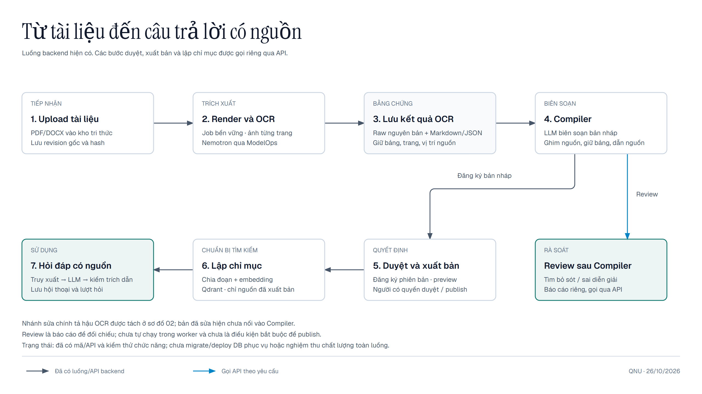
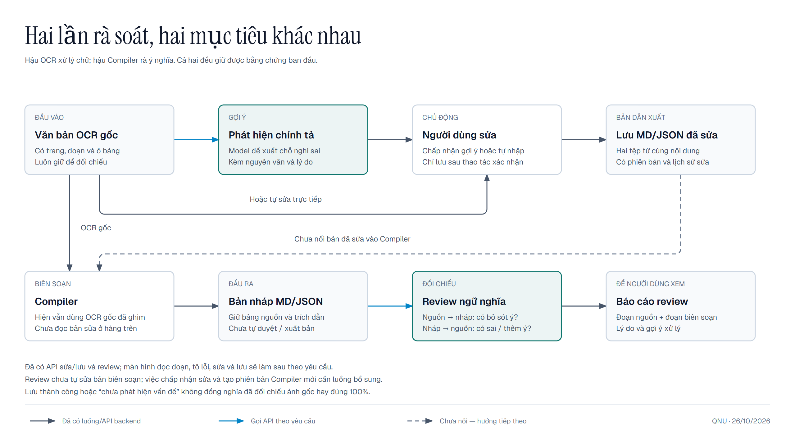
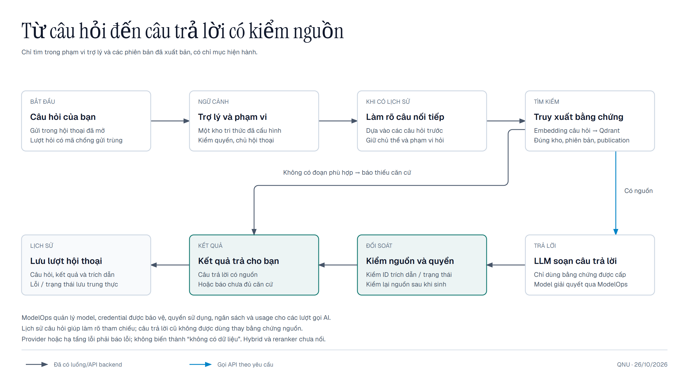

# Quy trình QNU AI Platform — Backend v1

> Bản chụp lịch sử Context653, trước khi nối ba bước ở Context654. Luồng hiện tại
> xem [quy trình29](../quy_trinh/29_noi_hau_ocr_review_va_sua_compiler_backendv1.md):
> Compiler đã chọn được text version, tự tạo review và lưu bản sửa thành run con.
> Các hình dưới đây được giữ để đối chiếu lịch sử.

Cập nhật 26/10/2026, dựa trên mã và contract hiện tại đến Context652.
Đây là bản mô tả luồng đã có ở backend, chưa phải nghiệm thu vận hành đầu cuối.

[Mở bản HTML gồm ba sơ đồ](quy-trinh-qnu-backendv1-2026-10-26.html).

## 01 — Tổng quan

Upload PDF/DOCX vào collection → lưu revision gốc/hash → job bền vững/render/OCR
qua ModelOps → giữ raw và Markdown/JSON → Compiler bản nháp ghim nguồn → đăng ký
phiên bản/duyệt/xuất bản → chia đoạn/embedding/Qdrant → hỏi đáp có trích dẫn.

Review sau Compiler là nhánh gọi riêng để đọc báo cáo, hiện không phải cổng bắt
buộc của publication. Duyệt/publish/index là các thao tác API riêng, không tự chạy
chỉ vì tài liệu upload hoặc Compiler xong.

## 02 — Hai lần rà soát

Hậu OCR: đọc đoạn → model gợi ý lỗi chữ → người dùng chấp nhận hoặc tự sửa → lưu
cùng nội dung thành hai tệp MD/JSON có phiên bản. Bản OCR gốc giữ nguyên. Đã có
API, chưa có màn hình; **bản sửa chưa nối Compiler**, được thể hiện bằng nét đứt.

Hậu Compiler: API review đối chiếu source→draft và draft→source, trả báo cáo có
nguyên văn, trang/ô, lý do và gợi ý. Chưa tự chạy trong worker, tự sửa hoặc duyệt
bản nháp. Không coi no_issues_detected là đúng100% hoặc approved.

## 03 — Hỏi đáp

Trợ lý ghim một collection và cấu hình; hội thoại có owner và snapshot. Câu hỏi
nối tiếp được làm rõ từ câu hỏi trước, rồi retrieval đúng phạm vi/nguồn đã xuất bản.
Có bằng chứng → LLM tạo câu trả lời → kiểm nguồn/quyền/trích dẫn → trả kết quả và
lưu lượt. Không có hit phù hợp thì báo thiếu căn cứ; provider/hạ tầng lỗi báo lỗi.
Lịch sử câu trả lời không thay bằng chứng nguồn. Chưa nối hybrid/reranker.

## Ranh giới trạng thái

- Đã có mã/API backend và kiểm thử chức năng; chưa migrate/deploy DB phục vụ.
- Giao diện nghiệp vụ sẽ làm sau theo phạm vi người dùng đã chốt.
- ModelOps giải quyết động model, credential được bảo vệ, quyền, quota và usage.
- Tài liệu/OCR gốc, revision/hash và lịch sử biến đổi phải giữ để truy vết.
- Chất lượng OCR/chính tả/Compiler/review/RAG trên corpus thật chưa được nghiệm thu.

Nguồn: [OCR](../../backendV1/docs/ocr-processing.md),
[text review](../../backendV1/docs/ocr-text-review.md),
[Compiler](../../backendV1/docs/compiler-v1.md),
[Compiler review](../../backendV1/docs/compiler-review.md),
[publication](../../backendV1/docs/compiled-publication.md),
[index/search](../../backendV1/docs/dense-indexing.md),
[answer](../../backendV1/docs/rag-answers.md),
[assistants/conversations](../../backendV1/docs/assistants-conversations.md).
