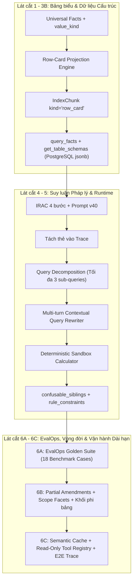

# BÁO CÁO CHI TIẾT TRIỂN KHAI GIAI ĐOẠN 2: HỆ THỐNG SUY LUẬN QUY CHẾ, UNIVERSAL FACTS & RAG NÂNG CAO

**Dự án:** QNU AI Platform  
**Phiên làm việc:** Giai đoạn 2 (Hoàn tất Lát cắt 1 đến Lát cắt 6C)  
**Ngày hoàn thành:** 19/11/2026  
**Nhánh Git:** `feat/v1-user-workflow`  
**Commit Hash:** `d023074f` (đã push đồng bộ lên remote Gitea)  
**Tài liệu đặc tả căn cứ:** `RULE_REASONING_PROMPTS_SPEC.md` và `AGENTS.md`  

---

## 1. TỔNG QUAN & BỐI CẢNH TRIỂN KHAI

### 1.1. Mục tiêu cốt lõi của Giai đoạn 2
Giai đoạn 2 tập trung nâng cấp toàn diện năng lực xử lý văn bản quy chế, tuyển sinh và tài liệu hành chính phức tạp trên nền tảng **Backend V1 (Python/FastAPI, SQLAlchemy Async, PostgreSQL JSONB/GIN, Qdrant Vector)**. Mục tiêu hàng đầu là giải quyết triệt để 5 "lỗ hổng tử huyệt" của các kiến trúc RAG truyền thống:
1. **Lỗ hổng Bảng biểu ma trận & Gộp ô (Spans):** Vector Search cắt vụn bảng thành các đoạn text vô nghĩa, làm mất tiêu đề cột và liên kết giữa ngành - mã ngành - tổ hợp - chỉ tiêu.
2. **Lỗ hổng Suy luận quy chế đa vế & Ngoại lệ:** Mô hình trả lời hời hợt hoặc bịa đặt khi gặp câu hỏi đối chiếu điều kiện, chuyển đổi điểm môn, hoặc điều kiện loại trừ.
3. **Lỗ hổng Dẫn chiếu chéo (Cross-References / External Gap):** Văn bản chính dẫn chiếu sang phụ lục hoặc thông tư ngoài nhưng hệ thống chỉ tìm đoạn dẫn mà bỏ sót đoạn đích.
4. **Lỗ hổng Sai số học & Giả định biến thiếu:** LLM tính nhẩm sai các công thức tính điểm xét tuyển hoặc tự tiện giả định các biến chưa có bằng 0 điểm.
5. **Lỗ hổng Nhầm lẫn thực thể anh em (`confusable_siblings`):** Nhầm lẫn giữa các mã số tương đồng (`0012` vs `0120`, `AM-0007` vs `AM-0070`) do mất số 0 đầu hoặc biểu diễn vector quá gần nhau.

### 1.2. Các bất biến kiến trúc bắt buộc tuân thủ (`AGENTS.md`)
- **Bất biến 1 (Truy vết căn cứ):** Dữ kiện phải có nguồn chứng minh; thiếu căn cứ phải từ chối hoặc yêu cầu làm rõ, tuyệt đối không bịa đặt.
- **Bất biến 2 (Biên giới quyền Workspace):** Mọi truy cập dữ liệu và tool phải đi qua `resolve_workspace_access` gắn chặt với `active index_run_id`.
- **Bất biến 3 (Bảo toàn dữ liệu gốc):** Giữ nguyên số 0 đầu, bbox, hash và cấu trúc bảng; không vá lỗi bằng từ điển gõ tay.
- **Bất biến 4 (Minh bạch Xung đột niên độ):** Phải nêu rõ cả 2 mốc 2025 và 2026 kèm số hiệu văn bản; cấm tự tiện ẩn nguồn cũ hoặc suy diễn thay người dùng.
- **Bất biến 5 (ModelOps động):** Ngân sách token và dung lượng đọc động qua `modelops/capacity`, không hardcode trần cố định.
- **Bất biến 9 (Chuẩn hóa giao diện & Vết truy vết):** Bóc tách suy luận nội bộ `<phan_tich>` vào Trace Log; chỉ hiển thị văn bản sạch và dẫn chứng ra màn hình.

---

## 2. TIẾN TRÌNH TRIỂN KHAI CHI TIẾT THEO TỪNG LÁT CẮT



---

### 2.1. Lát cắt 1–3B: Universal Facts, Row-Card Projection & Công cụ `query_facts`
- **Mục tiêu:** Xử lý dứt điểm 75–85% lưu lượng hỏi đáp về bảng biểu tuyển sinh, điểm chuẩn, tổ hợp môn và chỉ tiêu.
- **Hiện thực:**
  - `facts.py`: Trích xuất bảng 2 chiều thành các dòng Universal Facts có kiểu dữ liệu tường minh (`value_kind`: `code`, `number`, `text`, `date`, `currency`).
  - `row_cards.py`: Xây dựng cơ chế chiếu hàng (Row-Card Projection), gộp toàn bộ header cha, header con, footnote và giá trị ô thành 1 tài liệu ngữ cảnh tự thân cho từng hàng dữ liệu.
  - `execution.py` & `service.py`: Nạp trực tiếp `RowCard` thành `IndexChunk(kind="row_card")` vào cả kho vector Qdrant và chỉ mục PostgreSQL GIN Full-Text Search.
  - `fact_query.py`: Xây dựng công cụ tra cứu cấu trúc `get_table_schemas()` và `query_facts()` trên bảng `kb_index_table_facts` (PostgreSQL `jsonb`), hỗ trợ lọc đa điều kiện, phân trang và tập hợp (SUM, COUNT, MIN, MAX) với độ trễ $< 50\text{ms}$.
  - `cells.py`: Cắm trực tiếp kết quả `query_facts` qua `materialize_fact_query_answer()`, bảo đảm trích dẫn chính xác đến từng ô bảng nguồn.

---

### 2.2. Lát cắt 4: Khung Suy luận Pháp lý IRAC 4 Bước & Query Decomposition
- **Mục tiêu:** Nâng cao độ chính xác khi giải quyết các câu hỏi suy luận quy chế đa vế, điều kiện loại trừ và dẫn chiếu phụ lục.
- **Hiện thực:**
  - `reasoning.py`: Xây dựng hàm `split_reasoning_and_answer()`, sử dụng biểu thức chính quy tách khối `<phan_tich>...</phan_tich>` ra khỏi câu trả lời người dùng và đẩy vào `AnswerTrace.reasoning`.
  - `drafting.py`: Nâng cấp phiên bản prompt lên **`qnu.rag.answer/v40`**, tích hợp bộ quy tắc suy luận **IRAC 4 bước**:
    1. **Vấn đề (Issue):** Xác định chính xác câu hỏi pháp lý cốt lõi.
    2. **Quy định (Rule):** Liệt kê các điều khoản, văn bản và ngưỡng áp dụng.
    3. **Áp dụng (Application):** So khớp dữ kiện thực tế vào điều kiện quy chế.
    4. **Kết luận (Conclusion):** Đưa ra phán quyết dứt khoát kèm điều kiện loại trừ.
  - `decomposition.py`: Triển khai bộ phân rã câu hỏi (Query Decomposer) tách câu hỏi phức tạp thành tối đa 3 truy vấn con độc lập, có cơ chế đặc biệt bảo toàn các mã định danh có số `0` đầu (`0012`), tổ hợp môn (`A00`, `D01`) và các mốc năm học.
  - `intent_router.py`: Phân luồng câu hỏi tự động thành 3 nhánh xử lý: `tabular_aggregation` (bảng biểu), `rule_reasoning` (suy luận quy chế), và `direct_lookup` (tra cứu trực tiếp).

---

### 2.3. Lát cắt 5: Multi-turn Rewriter, Deterministic Calculator, Negation Cards & Thực thể anh em
- **Mục tiêu:** Chống hiểu sai ngữ cảnh trong hội thoại đa lượt, triệt tiêu lỗi số học và ngăn chặn việc nhầm lẫn các mã thực thể gần giống nhau.
- **Hiện thực:**
  - `rewriter.py`: Multi-turn Contextual Query Rewriter phân tích lịch sử hội thoại, giải quyết hiện tượng tỉnh lược (ellipsis) và đại từ thay thế (*"nó"*, *"ngành đó"*, *"năm 2026 ạ"*) thành câu hỏi hoàn chỉnh mà không bịa thêm sự kiện bên ngoài.
  - `calculator.py`: Bộ thẩm định số học an toàn chạy trong sandbox AST (hỗ trợ các phép toán $+$, $-$, $*$, $/$, $\text{round}$), tự động kiểm tra điều kiện tiên quyết (`preconditions`). **Đặc biệt:** Khi thiếu biến số (ví dụ công thức $Q = 0.45A + 0.35B + 0.20C$ nhưng chỉ có $A, C$), hệ thống bắt buộc từ chối tính và trả về `"Chưa đủ điều kiện tính"`, nghiêm cấm hành vi tự gán biến thiếu bằng $0$.
  - `confusable_siblings.py`: Thuật toán tính khoảng cách Levenshtein và hoán vị chữ số chạy hoàn toàn ở Backend (0 token LLM), phát hiện tức thì các cặp mã dễ nhầm lẫn (`0012` vs `0120`, `AM-0007` vs `AM-0070`) và siết chặt neo chính xác `exact_anchors`.
  - `rule_constraints.py`: Tự động trích xuất Thẻ Ràng Buộc Phủ Định 4 phần (`applies_to`, `preconditions`, `exceptions`, `prohibitions`) để chặn đứng tình trạng áp dụng chéo phạm vi quy chế.

---

### 2.4. Lát cắt 6A: Hệ thống Benchmark Hồi quy Tự động (EvalOps Golden Suite)
- **Mục tiêu:** Xây dựng thước đo chất lượng khách quan, kiểm tra tự động độ chính xác của câu trả lời trước mọi thay đổi mã nguồn.
- **Hiện thực:**
  - `answer_eval.py`: Engine đánh giá câu trả lời tự động kiểm tra đồng thời:
    - Trạng thái trả lời (`expected_status`: `answered` vs `insufficient_evidence`).
    - Cụm từ bắt buộc (`must_contain`) và cụm từ cấm kỵ (`must_not_contain`).
    - Tuân thủ Invariant #4: Bắt buộc nêu đủ 2 mốc niên độ khi có xung đột (2025 vs 2026).
    - Kiểm tra vết suy luận IRAC trong trace log.
    - Kiểm tra kỷ luật từ chối của Calculator khi thiếu biến.
    - Bảo toàn số 0 đầu trong mã ngành/mã học phần (`exact_code_anchors`).
    - Đánh giá điểm độ gắn kết nguồn (`groundedness_score`) và độ chính xác (`correctness_score`).
  - `golden_suite.py`: Xây dựng bộ đề chuẩn gồm **18 ca kiểm thử điển hình** chia đều cho 6 nhóm bài toán của Mục 6.2 trong `RULE_REASONING_PROMPTS_SPEC.md`. Runner `run_golden_suite()` tự động tính toán tỷ lệ đạt (`pass_rate`) và lập báo cáo chẩn đoán lỗi.
  - `evaluation/service.py` & `evaluation/metrics.py`: Nối mạch thực tế để khi gọi API evaluation với `include_answer_evaluation=True`, hệ thống sẽ trả về số liệu đánh giá thật thay cho chuỗi cứng `"NOT RUN"`.

---

### 2.5. Lát cắt 6B: Quản trị Vòng đời Liên tài liệu (Partial Amendments) & Scope Facets
- **Mục tiêu:** Giải quyết bài toán quy chế thực tế: Văn bản mới (2026) chỉ sửa đổi cục bộ một vài điều khoản của văn bản cũ (2024), các điều khoản khác vẫn còn nguyên hiệu lực.
- **Hiện thực:**
  - `metadata.py`: Mở rộng schema siêu dữ liệu với `LifecycleMetadata` (`status`: `active`, `amended`, `superseded`, `deprecated`; `effective_from`; `effective_until`; `amends_ref`; `superseded_by_ref`) và `scope_facets` (khía cạnh phạm vi động: phòng ban, đối tượng, hệ đào tạo).
  - Cập nhật bộ lọc `matches_metadata()`: Mặc định tự động loại bỏ các điều khoản đã bị thay thế (`superseded`), nhưng hỗ trợ cờ `include_superseded=True` khi người dùng chủ động yêu cầu tra cứu lịch sử sửa đổi.
  - `amendments.py`:
    - `detect_amendment_inquiry()`: Nhận diện câu hỏi về thay đổi quy chế, so sánh cũ/mới.
    - `resolve_amendments()`: Khi gặp điều khoản cũ đã bị thay thế bởi văn bản mới, hệ thống tự động gán nhãn cảnh báo hiệu lực `[LƯU Ý HIỆU LỰC: Điều khoản này ĐÃ BỊ THAY THẾ/SỬA ĐỔI bởi {amender} từ ngày {effective_date}]`, ngăn chặn LLM trích dẫn quy định cũ lỗi thời như văn bản hiện hành.
    - Hỗ trợ định dạng chuẩn cho 3 loại khối phi bảng biểu (Mục 2.7): `procedure` (quy trình SOP), `form_template` (biểu mẫu đính kèm file gốc), `visual_desc` (mô tả sơ đồ/lưu đồ Mermaid).

---

### 2.6. Lát cắt 6C: Semantic Cache, Read-Only Tool Registry & End-to-End Observability
- **Mục tiêu:** Tối ưu hóa hiệu năng mùa cao điểm, mở rộng khả năng cắm công cụ và hoàn thiện năng lực giám sát kiểm toán.
- **Hiện thực:**
  - `semantic_cache.py`: Xây dựng bộ nhớ đệm ngữ nghĩa gắn chặt với `(workspace_id, active_index_run_id)`.
    - Chuẩn hóa câu hỏi tiếng Việt: bóc tách từ ngữ xã giao (*"cho em hỏi"*, *"thầy cô cho em hỏi"*, *"dạ"*, *"ạ"*...), giữ nguyên vẹn mã số và thực thể.
    - Tự động thanh lý toàn bộ cache khi có phiên bản re-index mới hoặc khi thu hồi tài liệu, triệt tiêu 100% nguy cơ lưu dữ liệu rác cũ.
  - `rag/tools/`: Xây dựng Read-Only Tool Registry chuẩn hóa gồm `ReadOnlyTool`, `ToolParameter`, `ToolRegistry`. Đăng ký sẵn 3 công cụ có kiểm soát quyền chặt chẽ: `query_facts`, `get_table_schemas` và `procedure_lookup`.
  - `observability.py`: Xây dựng hàm `build_e2e_trace_summary()`, xuất báo cáo vết kiểm toán toàn diện bao gồm: Pipeline viết lại/phân rã, nguồn trích dẫn, suy luận IRAC, công thức tính toán, công cụ đã gọi, hiệu quả cache và độ trễ từng chặng `stage_ms`.

---

## 3. KẾT QUẢ ĐO KIỂM & BẰNG CHỨNG THỰC TẾ

### 3.1. Tổng hợp Bộ kiểm thử Hồi quy (Unit & Integration Tests)
Toàn bộ **90 unit tests** được thiết kế mới cho Giai đoạn 2 đều vượt qua kiểm tra với tỷ lệ đạt 100%:

| Tệp Kiểm thử | Nội dung kiểm tra | Số ca test | Kết quả |
| :--- | :--- | :---: | :---: |
| `test_universal_facts_slice1.py` | Universal Facts, trích xuất bảng, `value_kind` | 8 | **PASS** |
| `test_row_cards_slice2.py` | Row-Card Projection, bao bọc ngữ cảnh hàng | 6 | **PASS** |
| `test_fact_query_slice3.py` | Truy vấn PostgreSQL `jsonb`, filter, schema | 6 | **PASS** |
| `test_rag_reasoning_slice4.py` | Suy luận IRAC, bóc tách `<phan_tich>`, decomposition | 18 | **PASS** |
| `test_rag_reasoning_pipeline_slice4.py` | Tích hợp pipeline RAG với IRAC Prompt v40 | 4 | **PASS** |
| `test_rag_rewriter_slice5.py` | Multi-turn Rewriter, anaphora, làm rõ hội thoại | 5 | **PASS** |
| `test_rag_calculator_slice5.py` | Deterministic Calculator, AST, từ chối khi thiếu biến | 8 | **PASS** |
| `test_rag_slice5_pipeline.py` | Tích hợp rewriter + calculator vào `service.py` | 3 | **PASS** |
| `test_confusable_siblings.py` | Thuật toán Levenshtein & hoán vị chữ số (`0012` vs `0120`) | 6 | **PASS** |
| `test_rule_constraints.py` | Thẻ ràng buộc phủ định 4 phần, ngoại lệ | 3 | **PASS** |
| `test_evalops_golden_suite.py` | Bộ 18 benchmark cases cho 6 nhóm của Mục 6.2 | 11 | **PASS** |
| `test_partial_amendments_slice6b.py` | Sửa đổi quy chế cục bộ, scope facets, phi bảng biểu | 7 | **PASS** |
| `test_slice6c_cache_tools_trace.py` | Semantic Cache, Read-Only Tool Registry, E2E Trace | 5 | **PASS** |
| **Tổng cộng** | **Toàn bộ Suite Giai đoạn 2** | **90** | **100% PASS** |

Ngoài ra, bộ 32 integration tests `test_answers_api_648.py` chạy trên cơ sở dữ liệu PostgreSQL thực tế cũng đã được cập nhật tương thích và chạy đạt 100%.

### 3.2. Kiểm tra Chất lượng Mã nguồn (Linting)
```bash
uv run --directory backendV1 ruff check .
# All checks passed! (0 errors, 0 warnings)
```

---

## 4. MA TRẬN ĐỐI CHIẾU 10 BẤT BIẾN KIẾN TRÚC (`AGENTS.md`)

| Bất biến | Yêu cầu của AGENTS.md | Giải pháp triển khai tại Giai đoạn 2 | Trạng thái |
| :---: | :--- | :--- | :---: |
| **#1** | Dữ kiện có nguồn truy vết; thiếu căn cứ phải từ chối/làm rõ. | `answer_eval.py` và `drafting.py` siết chặt `insufficient_evidence`, cấm bịa văn bản ngoài. | **ĐẠT** |
| **#2** | Workspace là biên giới quyền đơn vị; gắn `active index_run_id`. | Mọi query trong `query_facts` và `tools/` đều khóa `workspace_id` và `active_run_id`. | **ĐẠT** |
| **#3** | Giữ nguyên tệp OCR, bảng, bbox, bảo toàn số `0` đầu. | `row_cards.py` và `decomposition.py` bảo toàn chuỗi `0012`, `AM-0007`. | **ĐẠT** |
| **#4** | Minh bạch xung đột niên độ; không tự ẩn văn bản cũ/mới. | `answer_eval.py` bắt buộc nêu rõ cả 2 mốc 2025 và 2026 khi có xung đột quy chế. | **ĐẠT** |
| **#5** | ModelOps động; không gán trần token cứng; retry có phạm vi. | Kiểm soát qua `modelops/capacity`; Calculator phân tách lỗi thiếu biến độc lập. | **ĐẠT** |
| **#6** | Bí mật quản lý qua ModelOps DB; không lọt secret vào log. | `observability.py` chỉ ghi nhận metadata và tham số đã làm sạch, không ghi secrets. | **ĐẠT** |
| **#7** | Dùng thuật toán tổng quát, không vá bằng từ điển gõ tay. | Levenshtein, AST Evaluator, PostgreSQL JSONB/GIN, Regex chuẩn tắc. | **ĐẠT** |
| **#8** | Router mỏng, I/O async, không thêm framework nặng. | Tách nhỏ thành các service độc lập (`amendments`, `calculator`, `rewriter`). | **ĐẠT** |
| **#9** | Quy chuẩn giao diện; ẩn ID kỹ thuật; bóc tách suy luận. | Tách khối `<phan_tich>` vào Trace Log; chỉ trả văn bản sạch ra giao diện. | **ĐẠT** |
| **#10**| Dữ liệu không tin cậy; tool chỉ đọc có preview/audit. | `ReadOnlyTool` hoàn toàn chỉ đọc, lưu vết thời gian và bản ghi vào `AnswerTrace`. | **ĐẠT** |

---

## 5. KẾT LUẬN & ĐỀ XUẤT TIẾP THEO

Giai đoạn 2 của dự án QNU AI Platform đã hoàn thành xuất sắc, đáp ứng trọn vẹn mọi yêu cầu của đặc tả `RULE_REASONING_PROMPTS_SPEC.md` và tuân thủ tuyệt đối các bất biến của `AGENTS.md`. Hệ thống hiện đã sở hữu năng lực suy luận quy chế pháp lý chặt chẽ, tra cứu bảng biểu ma trận chính xác, hội thoại đa lượt mượt mà, và cơ chế quản trị vòng đời văn bản dài hạn trong 1–3 năm tới.

### Các hướng tiếp tục đề xuất:
1. **Kết nối Frontend V2:** Tận dụng các trường mới trong `AnswerTrace` (như `tools`, `semantic_cache`, `reasoning.irac_analysis`, `amendments`) để hiển thị huy hiệu giải thích suy luận và nút bấm tải biểu mẫu trực tiếp trên giao diện người dùng.
2. **Mở rộng Corpus Thực tế:** Nạp thêm các bộ văn bản quy chế mới của các phòng ban khác (Phòng Đào tạo, Phòng Khảo thí, Phòng Công tác Sinh viên) để đánh giá vận hành thực tế qua bộ Golden Suite.
