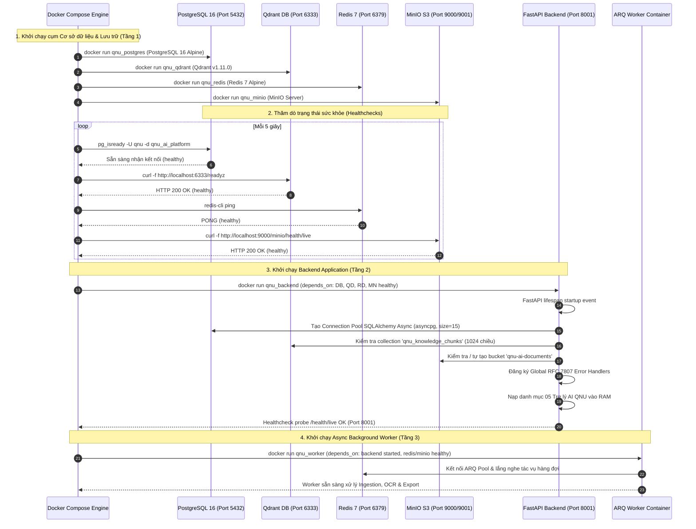

# QUY TRÌNH 01: KHỞI ĐỘNG & VÒNG ĐỜI NỀN TẢNG (BOOT SEQUENCE & PLATFORM LIFECYCLE)

Tài liệu này mô tả chi tiết thứ tự điều phối nạp các container, kiểm tra tính sẵn sàng (Healthcheck Probes) và khởi tạo kết nối hạ tầng khi nền tảng khởi động.

## Worker ingestion đa người — cập nhật #376

- ARQ dùng `max_tries` đúng phiên bản thư viện, mặc định 3; `WORKER_MAX_JOBS=10`, `WORKER_JOB_TIMEOUT_SECONDS=900`. Docker worker có probe `arq --check` mỗi 30s thay vì disable healthcheck; cron điều phối mỗi 15s.
- Job ingestion/index có Redis lease riêng và lease theo nguồn; renew/heartbeat 15s. Mất lease/heartbeat lỗi hủy execution để không tiếp tục ghi kết quả; timeout đi qua phục hồi DB, không retry trực tiếp mục còn processing.
- Cron chỉ reclaim khi không có job/resource lease và heartbeat quá hạn (timeout +120s, mặc định 17,5 phút), hoặc job failed được đánh dấu lỗi tạm thời. Kiểm tra scope, giữ item thành công, không phục hồi batch đã hủy; reset trạng thái dưới lock và phát lại qua pending dispatch. Staging index bỏ lại đánh dấu failed, không chạm active index.
- Giới hạn hạ tầng (không phải credentials LLM) cấu hình qua Settings: OCR_MAX_CONCURRENT=2, EMBEDDING_MAX_CONCURRENT=4, PROVIDER_QUEUE_TIMEOUT_SECONDS=120, INGESTION_MAX_PENDING_PER_TENANT=1000. Mọi replica cần cùng cấu hình. Đây là mặc định ban đầu, chưa phải sức chứa server GPU đã benchmark.
- Để nhận thay đổi phải khởi động lại backend/worker. Khi triển khai nhiều replica, drain/stop worker cũ trước khi bật recovery mới để tránh trộn phiên bản không có lease; không reset DB hay tự giết tác vụ người dùng đang chạy.

## Local dev cần worker — cập nhật #367

Trên Windows, `make dev` / `.\make.ps1 dev` khởi động API, Frontend và ARQ worker. Nếu API/Frontend đã chạy, dùng `.\make.ps1 worker` để mở riêng worker; launcher dùng PID kèm thời điểm khởi động để tránh mở trùng khi gọi tuần tự. Đây là tiện ích local dev, không phải trình giám sát production hay khóa chống hai launcher chạy đồng thời.

Nhánh PowerShell dev/dev1/dev2 mở Backend và Frontend bằng `WindowStyle Normal`/`NoExit` để hiển thị cửa sổ và theo dõi log. Worker vẫn chạy nền. Chạy dev khi worker đã tồn tại không restart/reload worker; cần chủ động restart đúng worker để nhận code mới. Thay đổi chế độ hiển thị chỉ áp dụng cửa sổ mới, không hiện lại process cũ đã mở ẩn; không cần reset DB.

Worker chạy nền, nhật ký stdout/stderr và thông tin PID nằm tại `backend/storage/worker_logs/` (được gitignore). Worker phải truy cập được PostgreSQL, Redis, MinIO/Qdrant và server AI theo cấu hình ModelOps. Heartbeat cập nhật mỗi 15 giây; một health key cũ còn tồn tại không đủ chứng minh worker đang hoạt động. Cần đối chiếu timestamp, process và tiến trình job.

API tạo job vào hàng đợi; worker thực hiện snapshot, parsing/OCR, chunking và build staging nếu đợt có vector generation đích. Đợt chỉ nạp nguồn không tự đồng nghĩa embedding/xuất bản. Worker không khôi phục batch đã hủy. Không reset DB để xử lý queue bị chờ.

Production nhiều người dùng: chạy worker dưới Docker/service có restart và giám sát, tách khỏi API. `max_jobs=10` hiện là giới hạn tác vụ đồng thời **mỗi worker**, không phải cam kết tải OCR 10 file lớn; cần đo RAM, timeout và năng lực server AI trước khi tăng worker/concurrency. Chưa benchmark tải nhiều người dùng trong phiên này.

## Chính sách seed Kho tri thức — cập nhật #347

Reset/seed/khởi động thông thường chỉ tạo 5 kho mặc định **trống**. Không tự thêm tài liệu mẫu, chunks, facts hoặc embedding. Kiểm tra readiness yêu cầu provider và kho mặc định đúng scope, **không yêu cầu kho có chunks**; nếu không, mỗi lần khởi động sẽ nạp mẫu trở lại.

Nội dung chỉ đến từ tài liệu thực tế người dùng nạp. Hàm legacy `seed_demo_knowledge` chỉ dành cho gọi chủ động để thử mẫu, không được gọi bởi `seed_default_knowledge`, CLI seed thông thường hay readiness. Seed không sửa cấu hình/nội dung các kho đã tồn tại.

Với DB cũ đã nạp mẫu, `python -m scripts.clear_seed_knowledge` xem trước; thêm `--apply` để sao lưu vào storage rồi dọn đúng các bản mẫu legacy còn nguyên nội dung. Công cụ từ chối tài liệu/chunks/facts bị chỉnh sửa hoặc thuộc Repository/index revision; không reset DB, không xóa tệp gốc, không drop namespace Qdrant. Bản sao lưu chứa các hàng DB và metadata để có thể phục hồi có kiểm soát.

---

## 1. Sơ Đồ Tuần Tự Khởi Động (Boot Sequence Sequence Diagram)

---

## 2. Chi Tiết Các Bước Thực Thi

### Bước 1: Khởi động Hạ tầng Lưu trữ & CSDL (Tầng 1)
- **PostgreSQL 16**: Cấu hình bộ nhớ đệm `shared_buffers`, nạp extension tiếng Việt cho Full-Text Search.
- **Qdrant Vector DB**: Nạp engine lưu trữ vector trên ổ cứng tại volume `qnu_qdrant_data`.
- **Redis 7**: Nạp cơ chế semantic cache và lưu trữ hàng đợi tác vụ của ARQ.
- **MinIO S3**: Khởi tạo object storage server tại cổng `9000` (API) và `9001` (Console).

### Bước 2: Thăm Dò Sức Khỏe (Healthcheck Polling)
Để tránh hiện tượng `CrashLoopBackOff` khi Backend khởi động trước khi CSDL sẵn sàng:
- Lệnh kiểm tra PostgreSQL: `pg_isready -U qnu -d qnu_ai_platform`.
- Lệnh kiểm tra Qdrant: `curl -f http://localhost:6333/readyz || exit 1`.
- Lệnh kiểm tra Redis: `redis-cli ping`.
- Lệnh kiểm tra MinIO: `curl -f http://localhost:9000/minio/health/live || exit 1`.

### Bước 3: Vòng Đời Ứng Dụng FastAPI (`lifespan`)
Được quản lý trong hàm `lifespan(app: FastAPI)` tại [`app/main.py`](file:///d:/DuAnPhanMem/DeTaiAI/qnu-ai-platform/backend/app/main.py):
1. **Khởi tạo Logger có cấu trúc**: Đăng ký structlog định dạng JSON kèm `correlation_id`.
2. **Khởi tạo Connection Pool CSDL**: `asyncpg` mở sẵn 15 kết nối tới PostgreSQL.
3. **Đăng ký RFC 7807 Exception Handlers**: Bắt và chuẩn hóa toàn bộ lỗi ngoại lệ thành Problem Details.
4. **Graceful Shutdown**: Khi nhận tín hiệu `SIGTERM`, server ngưng nhận request mới, đợi các request đang chạy hoàn tất và đóng Connection Pool (`await engine.dispose()`).
