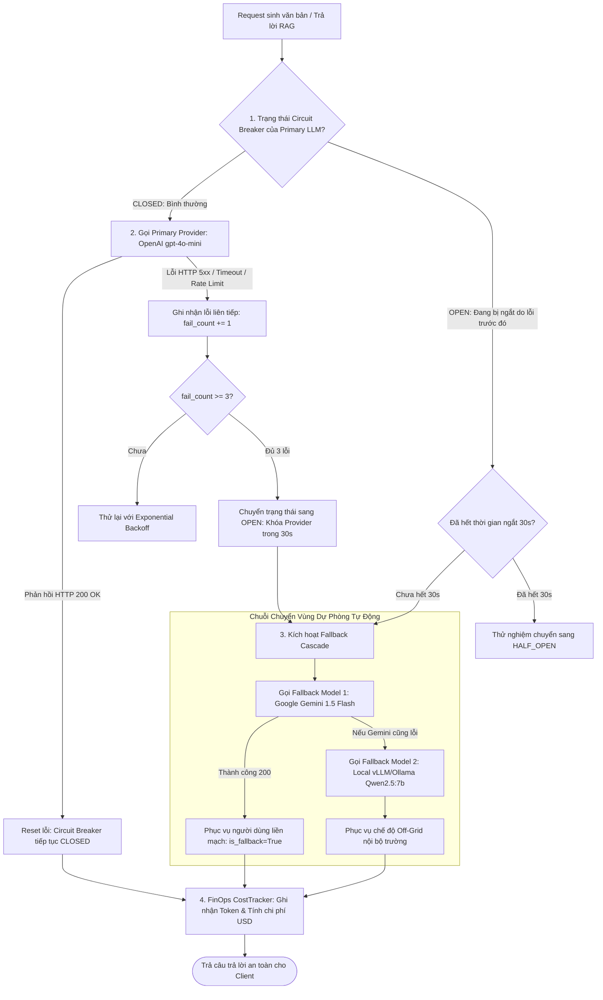

# QUY TRÌNH 06: QUẢN TRỊ MODELOPS, CIRCUIT BREAKER & DỰ PHÒNG TỰ ĐỘNG (MODELOPS RESILIENCE & FALLBACK FLOW)

Tài liệu này đặc tả cơ chế chịu lỗi của hệ thống khi kết nối các nhà cung cấp LLM ngoại vi (OpenAI, Google Gemini, Local vLLM/Ollama), thuật toán ngắt mạch Circuit Breaker 3 trạng thái, định tuyến dự phòng nhiều tầng (Fallback Cascade) và quản trị chi phí FinOps.

## Điều phối tải OCR/embedding — cập nhật #376

- #382 parse cache fingerprint gồm OCR routing/provider/model/timeout/update time từ ModelOps DB; không lưu key vào fingerprint hoặc log. Re-embedding source mới dùng structured artifact/facts đã lưu, không gọi OCR để đổi vector space. Reranker giữ riêng raw provider score cho threshold; malformed/NaN/index ngoài phạm vi không được scored-success.

- Paddle adapter (mọi đường gọi) và embedding vLLM/Ollama/OpenAI-compatible/Cloudflare dùng capacity lease Redis sorted-set với Lua atomic, thời gian Redis, renew và token release. Key theo endpoint đã hash, tránh cộng riêng capacity khi nhiều provider trỏ cùng endpoint; mỗi loại OCR/embedding có limit riêng.
- Khi đầy, chờ slot tối đa cấu hình rồi trả PROVIDER_CAPACITY_TIMEOUT; Redis không khả dụng trả PROVIDER_CAPACITY_UNAVAILABLE, không gọi AI bằng fallback giả. Lease có TTL để không rò rỉ capacity khi process chết; renew mất lease hủy request phía ứng dụng.
- Lỗi kết nối/timeout/429/5xx và các mã availability tạm thời được phân loại qua cause chain, ghi retry_after/backoff trong DB; cron retry có giới hạn. Nội dung rỗng, quality/parity/config sai không tự coi là lỗi mạng. Giữ cơ chế key rotation/fallback hiện hữu, không đổi model/credentials.
- Chưa benchmark GPU thật; giới hạn đang là số request phía ứng dụng, không cam kết Paddle/vLLM server đã dừng inference khi client timeout. Endpoint alias/khác port và cùng GPU cần cấu hình/đo tải server, chưa có group budget chung cho mọi model trên một GPU.

### Tích hợp RAG/DAG (#370)

RAG không tự gọi lại fallback hoặc trả trích đoạn khi ModelOps hết provider. Request LLM giữ tenant/model/provider/fallback; node LLM kế thừa provider profile khi không có node override. Chat provider types có thêm vllm/openai_compatible; proxy này chấp nhận tên model động trước kiểm tra family, không ép tên Qwen/custom về model seed. Vẫn không gửi embedding/reranker-only model vào chat. vLLM có key được quản lý DB/Key Pool như trước, Paddle giữ keyless.

Smoke thật #370: cấu hình trợ lý hiện tại được cascade sang Cloudflare và trả tokens thực; không chứng minh vLLM đang chạy chat vì preset vLLM chỉ embedding/reranker. Không sửa URL/model/keys hoặc tự publish kho người dùng để test. Các ca outage/quota/noDB được regression, chưa benchmark failover server thật/đổi key/failure concurrency.

---

## 1. Sơ Đồ Cơ Chế Ngắt Mạch & Chuyển Vùng Dự Phòng (Circuit Breaker & Fallback)

### Xác thực AI server (#355)

- **Reset dev/local (#357)**: Seed có thể khôi phục khóa vLLM từ `backend/storage/modelops-bootstrap/credentials.json` dưới dạng ciphertext, thư mục bị loại khỏi Git. `make reset-db` đi qua seed mặc định; chỉ preset mới được khởi tạo khóa vào DB primary/Key Pool, không ghi đè provider hiện có. Production bỏ qua. Giữ tệp bootstrap và cấu hình mã hóa app; đổi key server phải cập nhật bootstrap để lần reset sau không nạp khóa cũ.

- PaddleOCR (`paddleocr`, `paddleocr_vl`, `paddle`) không yêu cầu khóa. ModelOps chỉ cần Base URL; không hiển thị Key Pool. Kiểm tra dùng `GET /health` không Authorization, không chứng minh bóc tách tài liệu đã thành công.
- vLLM router cần khóa thật trong ModelOps trước khi kiểm tra/nạp vector. Thiếu khóa hoặc HTTP 401 không được coi là thành công.
- Seed riêng: chạy tại `backend` bằng `python -m scripts.seed_ai_server_providers` trong môi trường ảo. Chỉ thêm hai provider AI server còn thiếu; không ghi đè URL/model/khóa/defaults hiện có. Không chứa secret trong source hay `.env`.

---

## 2. Các Đặc Tuyến Kỹ Thuật Cốt Lõi

### 1. Vòng đời 3 trạng thái của Circuit Breaker
Triển khai tại [`app/modules/modelops/circuit_breaker.py`](file:///d:/DuAnPhanMem/DeTaiAI/qnu-ai-platform/backend/app/modules/modelops/circuit_breaker.py):
- **`CLOSED`**: Mọi request đi qua bình thường. Bộ đếm lỗi bằng 0.
- **`OPEN`**: Khi gặp 3 lỗi liên tiếp (timeout, 502, 503, 429), mạch ngắt lập tức, từ chối mọi request mới tới nhà cung cấp đó trong 30 giây để tránh làm nghẽn hàng đợi và tránh lãng phí thời gian chờ đợi.
- **`HALF_OPEN`**: Sau 30 giây, mạch cho phép 1 request đơn lẻ đi qua để thăm dò. Nếu thành công, mạch tự phục hồi về `CLOSED`; nếu thất bại, mạch lập tức chuyển lại về `OPEN` thêm 30 giây nữa.

### 2. Quản trị Hạn ngạch Token Tháng (Token Quota Enforcement)
- Hệ thống theo dõi số token sử dụng tích lũy của từng đơn vị/khoa phòng (Tenant).
- Khi vượt hạn ngạch tháng, hệ thống tự động khóa quyền gọi các mô hình đắt tiền (`gpt-4o`) và chuyển hướng sang các mô hình miễn phí chạy nội bộ (`qwen2.5:7b`).

### 3. Tối ưu Chi phí FinOps (CostTracker)
- Tự động bóc tách số `prompt_tokens` và `completion_tokens` của từng lượt gọi.
- Nhân với bảng giá chính thức (USD / 1.000.000 tokens) để ghi nhận chi phí vào bảng kiểm toán hệ thống.

### 4. Kiểm Thử Hiệu Lực Mô Hình LLM & Dọn Dẹp Model Hết Hỗ Trợ (Active Model Health Probing & 1-Click Cleanup)
- **Mục tiêu**: Đảm bảo các mô hình đang cấu hình trong Provider còn thực sự hoạt động, phát hiện sớm các model đã bị nhà cung cấp ngừng cung cấp (deprecated/404) hoặc hết hạn ngạch (429/403).
- **Endpoint Backend**: `POST /platform/v1alpha1/modelops/providers/{provider_id}/models/test`
  - Hỗ trợ payload `{ "model_name": "..." }` để test đơn lẻ hoặc để trống `{}` để test toàn bộ danh sách models của provider.
  - Kiểm soát đồng thời an toàn bằng `asyncio.Semaphore(5)` chống nghẽn đường truyền.
  - Cơ chế Lightweight Ping 1-token / model lookup phân nhánh thích ứng:
    - **Google Gemini**: Gọi endpoint `models/{model_id}:generateContent` với `maxOutputTokens: 1`. Bắt mã 404 (model không tồn tại/đã ngừng phục vụ).
    - **Cloudflare Workers AI**: Phân biệt mô hình embedding (`@cf/baai/bge-m3`) và LLM generation (`prompt`) với payload tối thiểu.
    - **Mistral AI**: Xử lý mô hình OCR chuyên biệt (`mistral-ocr-latest`) qua `GET /v1/models/{model}` và LLM qua `chat/completions` (max_tokens 1).
    - **OpenAI / Cổng tương thích OpenAI**: Ping qua `chat/completions` (max_tokens 1) hoặc `embeddings` (text "ping").
    - **Local / Docling / SentenceTransformers**: Kiểm tra registry in-memory nội bộ.
- **Trải Nghiệm UI & Dọn Dẹp 1-Click**:
  - Nút **[⚡ Test Tất Cả Models]** trên header thẻ *Mô Hình Khả Dụng* hiển thị spinner loading khi đang ping.
  - Khi phát hiện bất kỳ model nào bị 404/ngừng hỗ trợ, hệ thống hiển thị banner cảnh báo thông minh kèm nút **[🧹 Dọn Dẹp Model Lỗi]** để cán bộ quản trị loại bỏ ngay lập tức khỏi cấu hình chỉ với 1 click chuột.

### 5. Cơ Chế Observability & Thống Kê Chi Phí Thời Gian Thực (Real-Time Usage & Cost Tracking)
- **Mục tiêu**: Loại bỏ hoàn toàn số liệu giả lập/gán cứng trên Dashboard; lưu trữ và tổng hợp chính xác số lượt gọi, tổng số token tiêu thụ, chi phí quy đổi USD thật và độ trễ phản hồi của toàn bộ các giao tác LLM.
- **Tầng CSDL Bền Vững**:
  - Bảng `llm_usage_logs`: Lưu vết từng lượt gọi LLM (`id`, `tenant_id`, `assistant_id`, `provider`, `model_name`, `prompt_tokens`, `completion_tokens`, `total_tokens`, `cost_usd`, `latency_ms`, `is_fallback`, `status`).
  - Bảng `tenant_quotas`: Tự động cộng dồn `tokens_used` và `cost_used_usd` trong chu kỳ tháng.
- **Tầng Tính Toán Chi Phí (`app/modules/modelops/pricing.py`)**:
  - Bảng giá định danh chi tiết cho từng họ mô hình (OpenAI `gpt-4o-mini`: $0.15/$0.60 per 1M tokens; Gemini `gemini-1.5-flash`: $0.075/$0.30 per 1M tokens; Mistral OCR: $0.001/call; Local vLLM: $0.0).
- **Tích Hợp Tự Động (Telemetry Hooks)**:
  - Tích hợp ghi log trong cả 2 phương thức: `modelops_service.generate()` và `AssistantService.chat_stream()`.
- **API Phân Tích & Giám Sát**:
  - Endpoint `GET /platform/v1alpha1/modelops/usage-stats?days=30` trả về số liệu tổng hợp: `total_requests`, `total_tokens`, `total_cost_usd`, `avg_latency_ms`, danh sách phân bổ theo mô hình `models_breakdown` và diễn biến theo ngày `daily_usage` phục vụ trực tiếp biểu đồ thời gian thực trên Dashboard.

