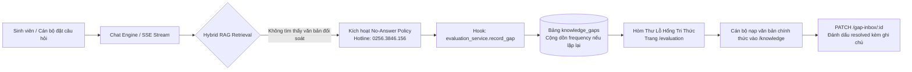

# QUY TRÌNH 07: KIỂM ĐỊNH CHẤT LƯỢNG RAGAS TM-08 (CONTINUOUS EVALUATION TM-08 FLOW)

Tài liệu này đặc tả quy trình đánh giá chất lượng tự động của hệ thống RAG và các Trợ lý AI dựa trên 3 chỉ số Ragas cốt lõi đáp ứng yêu cầu kỹ thuật đề tài nghiên cứu cấp trường (**Mã tiêu chuẩn: QNU TM-08**).

## Kiểm thử độc lập evidence — phiên #417

`scripts/evaluate_evidence_417.py` gửi nguyên câu hỏi từ bộ 82 câu đã trích xuất, không đưa expected answers vào yêu cầu hoặc kho evidence. Chạy tuần tự để tránh tranh chấp khóa model; mỗi câu độc lập dùng conversation mới. Báo cáo lưu cấu hình, fingerprint, manifest source/hash/revisions, trace từng node, model/provider/fallback/tokens/latency/chi phí thực và kiểm tra cấu hình/publication không thay đổi cuối lượt.

Phân biệt câu trả lời đúng, có sai, no-answer đúng vì thiếu nguồn, no-answer sai vì bỏ sót nguồn, và lỗi kỹ thuật. `answered`/`supported` là quyết định runtime, không phải nhãn accuracy độc lập. Quote khớp và số có trong quote chưa chứng minh đúng năm, thuộc tính hoặc điều kiện. Các ca 5/41/42/51/68/76–78 cần kiểm tra đặc biệt; ưu tiên nguồn phải được con người xác nhận trước, không suy từ đáp án benchmark.

No-answer không tự nhận Faithfulness 1.0 và heuristic overlap không được công bố là Ragas TM-08. Chỉ công bố ba điểm Ragas khi thật sự chạy evaluator, có reference/corpus chuẩn và báo cáo lưu kết quả. Phiên này chưa chạy Ragas. Test PostgreSQL opt-in (`QNU_TEST_EVIDENCE_DB=1`) dùng transaction rollback để kiểm tra hash/revision/scope và ô đã hiệu đính, có ca DB/provider lỗi fail-closed. Nguồn bổ sung cần cán bộ đối soát/phê duyệt theo quy trình kho tri thức, không nạp FAQ đang chấm làm đáp án cho chính benchmark đó.

Lượt test phải giữ nguyên mã/config/snapshot; không ghép các lượt dùng runtime khác thành một tỷ lệ accuracy. Script dừng khi mất kết nối dịch vụ, lưu `interruption_reason` và không gửi tiếp các câu còn lại. Phân biệt số ca đã thử, số phản hồi HTTP và số câu có đáp án; HTTP500/timeout/ConnectError không được chấm là lỗi dữ kiện. Báo cáo đối soát tham chiếu không tự coi FAQ là nguồn hiện hành: cần xét năm được người dùng hỏi/mặc định và văn bản cập nhật đã được cán bộ xác nhận ưu tiên. Trước chạy benchmark dài, chốt batch code để tránh dev hot-reload giữa lượt trả lời.

---

## 1. Sơ Đồ Quy Trình Đo Lường & Báo Động Lệch Chuẩn (Evaluation Flow)

```mermaid
flowchart TD
    CRON[Lịch chạy định kỳ / Kích hoạt thủ công qua API: POST /evaluation/runs] --> SEED[Nạp Bộ Dữ Liệu Benchmark Chuẩn QNU: 100 câu hỏi]
    
    SEED --> RUN_LOOP[Vòng lặp đánh giá từng mẫu kiểm thử]
    
    subgraph METRICS_CALCULATION [Tính Toán 3 Chỉ Số Ragas TM-08]
        RUN_LOOP --> M1[1. Faithfulness: Tính tỷ lệ câu khẳng định có căn cứ trong tài liệu]
        RUN_LOOP --> M2[2. Answer Relevance: Tính mức độ trả lời trúng trọng tâm câu hỏi]
        RUN_LOOP --> M3[3. Context Precision: Tính độ chính xác của các đoạn ngữ cảnh trích xuất]
        RUN_LOOP --> M4[4. Hallucination Detection: Quét số liệu, năm, mã ngành ngoài ngữ cảnh]
    end

    M1 --> AGGREGATE[Tổng hợp Điểm Trung bình của Đợt Chạy]
    M2 --> AGGREGATE
    M3 --> AGGREGATE
    M4 --> AGGREGATE

    AGGREGATE --> EVAL_GATE{Đối Soát Ngưỡng Chuẩn QNU TM-08?}
    
    EVAL_GATE -->|Faithfulness >= 0.90<br>Relevance >= 0.85<br>Precision >= 0.80<br>Zero Hallucination| PASS[ĐẠT CHUẨN TM-08 (PASSED)<br>Lưu báo cáo vào MinIO & Cho phép tiếp tục phục vụ]
    
    EVAL_GATE -->|Vi phạm bất kỳ ngưỡng nào| FAIL[CẢNH BÁO LỆCH CHUẨN (DRIFT DETECTED)<br>Gửi thông báo Telegram/Email cho Quản trị viên<br>Tạm khóa phiên bản Assistant vừa cập nhật]
```

---

## 2. Các Chỉ Số Đánh Giá Chuẩn QNU TM-08

| Chỉ Số Đánh Giá | Ngưỡng Chuẩn TM-08 | Công Thức / Cơ Chế Tính | Ý Nghĩa Kỹ Thuật |
| :--- | :---: | :--- | :--- |
| **Faithfulness** (Độ trung thực) | $\mathbf{\ge 0.90}$ | Tỷ lệ câu khẳng định trong câu trả lời có bằng chứng trực tiếp trong các Chunks trích xuất. Tự động đạt 1.0 khi kích hoạt No-Answer Policy. | **Triệt tiêu bịa đặt**: Bảo đảm Trợ lý không nói sai lệch so với văn bản chính thức của trường. |
| **Answer Relevance** (Độ liên quan) | $\mathbf{\ge 0.85}$ | Đo độ phủ từ khóa của câu hỏi trong câu trả lời kết hợp hệ số phạt độ dài (length penalty). | **Trúng trọng tâm**: Tránh trả lời vòng vo, né tránh hoặc quá ngắn cụt lủn. |
| **Context Precision** (Độ chính xác ngữ cảnh) | $\mathbf{\ge 0.80}$ | Tỷ lệ các Chunks trích xuất từ Qdrant/PostgreSQL có chứa thông tin cần thiết của Ground Truth. | **Hiệu quả truy xuất**: Bảo đảm tầng RAG chọn đúng văn bản liên quan nhất lên đầu. |
| **Hallucination Detection** (Bắt số liệu ảo) | **0 vi phạm** | Bộ lọc Regex quét tìm các con số (điểm chuẩn, học phí, số điện thoại) xuất hiện trong câu trả lời nhưng không có trong tài liệu gốc. | **Cảnh báo khẩn cấp**: Phát hiện ngay lập tức nếu AI tự bịa ra điểm thi hay hotline giả mạo. |

---

## 3. Quản Trị & Lưu Trữ Kết Quả Đánh Giá
- Mọi đợt kiểm định đều được lưu bản ghi vào bảng CSDL `evaluation_runs`.
- Báo cáo chi tiết từng câu hỏi (kèm lý do đạt/hỏng) được xuất thành tệp JSON/Excel lưu trữ bền vững tại **MinIO** (`artifacts/eval_report_UUID.xlsx`).

---

## 4. Hòm Thư Lỗ Hổng Tri Thức (Knowledge Gap Inbox) & Vòng Lặp Học Chủ Động (Active Remediation)

Bên cạnh benchmark định kỳ, hệ thống thiết lập cơ chế **Active Learning khép kín** nhằm liên tục phát hiện và bổ sung tri thức thiếu hụt từ người dùng thực tế:



1. **Thu Thập Tự Động (Automatic Gap Capture)**:
   - Khi luồng chat trả về `status == "insufficient_context"`, câu hỏi người dùng được tự động đẩy vào bảng `knowledge_gaps`.
   - Nếu câu hỏi đã tồn tại ở trạng thái `pending`, hệ thống tự động tăng `frequency += 1` để xếp hạng các chủ đề sinh viên quan tâm nhiều nhất lên đầu.
2. **Khắc Phục Chủ Động (Active Remediation)**:
   - Chuyên viên phòng ban truy cập `/evaluation` xem danh sách câu hỏi chưa có tài liệu trả lời.
   - Nút **[Nạp Tri Thức Bổ Sung]** dẫn thẳng sang `/knowledge` để tải lên văn bản chính thức tương ứng.
   - Nút **[Đánh Dấu Đã Nạp]** cập nhật trạng thái `resolved` kèm số hiệu văn bản vừa ban hành.
